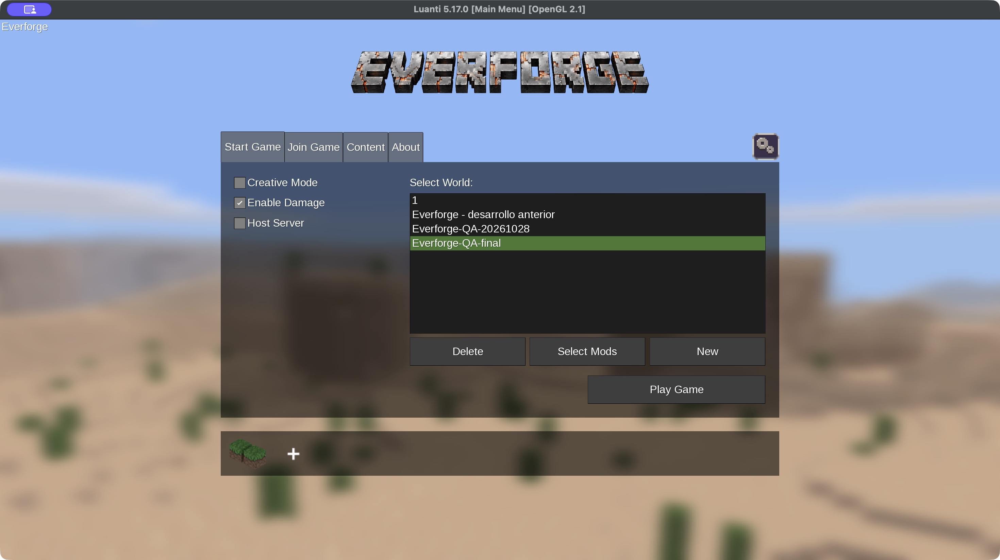
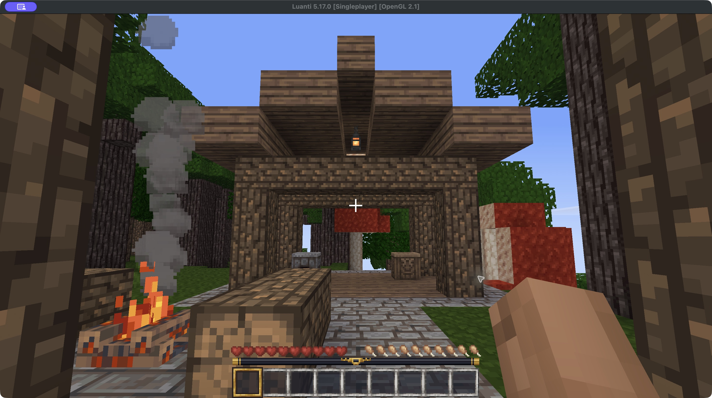
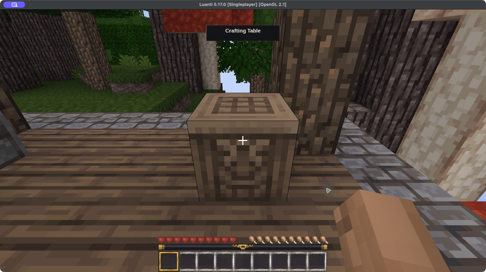
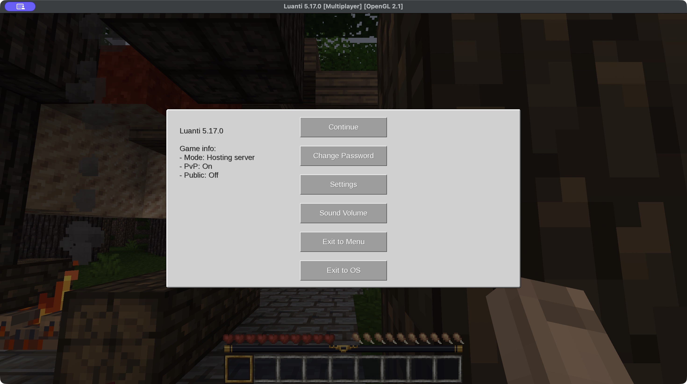

# Campamento, HUD y launcher nativo — 28/10/2026

## Resultado

Everforge se abre desde la aplicación oficial Luanti 5.17.0 y aparece con su nombre y cabecera en el selector. Crear, seleccionar, continuar, hospedar y conectarse usan exclusivamente el menú nativo. No se añadió un launcher propio.

En la carpeta local Everforge, `Luanti.app` enlaza la aplicación instalada en Downloads. No abre Terminal. Se retiraron los dos `.command`, que pasaban `--go` y saltaban el menú. El CLI de `tools/` sigue disponible solo para pruebas aisladas.

La instalación normal registra el juego en `~/Library/Application Support/minetest/games/mineclonia`. Se mantiene ese identificador histórico y el título visible Everforge. El yunque y la cabecera permanecen separados. El enlace local a la aplicación no se versiona: en otra computadora hay que instalar Luanti y registrar la carpeta como juego.

## Causa y corrección del campamento

El prototipo anterior sí colocaba bloques, pero solo una plataforma pequeña y dos estaciones, sin una construcción reconocible. Además, la búsqueda aceptaba copas como suelo y priorizaba posiciones altas al llegar; en biomas densos podía situar al jugador sobre vegetación y ocultar el recinto.

Ahora se busca suelo natural, se prioriza la altura del patio y se coloca un pabellón de roble con techo y soportes, fogata, bancos, caminos y faroles, usando nodos existentes. Solo durante la creación inicial se retira vegetación natural del recinto. La llegada alternativa continúa leyendo el mundo sin romper construcciones.

La colocación valida materiales y comprueba nodos físicos antes de marcar el manifiesto como listo. La región sigue siendo única por mundo, compartida y modificable. Un manifiesto listo nunca reconstruye ni limpia el campamento; una generación interrumpida requiere revisión. Camas y anclas conservan sus prioridades nativas. No se actualizan automáticamente campamentos antiguos encima del mundo del jugador.

## HUD

Se quitaron únicamente las líneas Tipo y Herramienta recomendada, incluido el relleno que las reintroducía. Permanecen nombre, nivel mínimo de minería e información adicional de máquinas o cultivos. Las reglas de herramientas y minería no cambian.

## Comprobaciones realizadas

- Aplicación gráfica oficial: Luanti 5.17.0, macOS ARM64, OpenGL 2.1. Everforge detectado y cabecera visible; creación desde el menú de `Everforge-QA-final`, singlenode, semilla 12345; refugio y fogata comprobados visualmente.
- Menú nativo: partida individual; reinicio de otro mundo de prueba como anfitrión `QAHost`; segundo cliente `QAVisitor` conectado al mismo servidor por 127.0.0.1:30000. El servidor nativo escuchó en todas las interfaces. Se cerró la sesión guardando el mundo.
- Runtime automatizado, mundo nuevo aislado: techo, postes, farol, fogata y estaciones comprobados como nodos reales; llegada a nivel del patio; productor real del HUD sin Tipo/Herramienta, conservando nivel mínimo. Reinicio aprobado conservando un bloque de oro y metadatos colocados por la prueba en el techo: no se reconstruyó encima.
- Pruebas Python de interfaces (5) y traducciones (3) aprobadas; revisión de espacios del diff aprobada.

Las capturas son del juego ejecutándose. Un mod temporal exclusivo de los mundos QA ajustó la cámara para reproducir las vistas; no creó estructuras. Se retira al finalizar. Los mundos y bases de datos no se incluyen en Git.

## Cómo jugar

1. Abrir `Luanti.app` en la carpeta local Everforge y seleccionar Everforge.
2. Individual: Iniciar juego → Nuevo, nombre y generador singlenode → Crear; dejar Hospedar servidor desmarcado → Jugar. Para continuar, seleccionar ese mismo mundo.
3. Con amigos: seleccionar un mundo existente → Hospedar servidor; nombre y contraseña propios, puerto 30000 → Hospedar partida. Dejar el anuncio público desmarcado si se quiere una sesión privada.
4. Invitado: Luanti → Unirse; IP local del anfitrión, puerto 30000 y nombre/contraseña propios. No usar 127.0.0.1 desde otra computadora. Los recursos del juego se descargan desde el anfitrión.

El modo individual usa `singleplayer`; hospedar usa el nombre introducido. Son perfiles distintos dentro del mismo mundo. Para retomar el perfil del antiguo acceso directo, usar su mismo nombre al hospedar. Se incorporó al listado nativo una copia del último mundo de desarrollo, con el original conservado; solo se adaptó el identificador del juego en la copia.

Desde Internet se requiere conectividad entre redes (por ejemplo red privada o redirección UDP 30000); no se cambiaron router ni firewall. La prueba del segundo cliente fue en esta computadora, no entre dos computadoras físicas ni a través de Internet. El diseño y selección de terreno se probaron con singlenode/12345, sin garantizar todos los biomas o semillas. Abrir el launcher nunca crea otro mundo automáticamente.

Más detalles: [guía jugable](everforge-playable.md).
